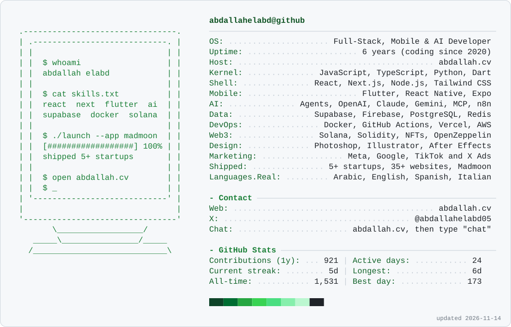

<a href="https://abdallah.cv">
  
</a>

<p align="center">
  <a href="https://abdallah.cv">
    
  </a>
</p>

<p align="center">
  <a href="https://abdallah.cv"></a>
  <a href="https://x.com/abdallahelabd05"></a>
  <a href="https://abdallah.cv/CV.pdf"></a>
  <a href="https://abdallah.cv"></a>
</p>

<p align="center">
  <picture>
    <source media="(prefers-color-scheme: dark)" srcset="https://raw.githubusercontent.com/abdallahelabd/abdallahelabd/output/card-dark.svg" />
    
  </picture>
</p>

<h2 align="center">🛠️ Tech stack</h2>

<p align="center">
  
  <br />
  
</p>

<h2 align="center">💻 Try my terminal</h2>

<p align="center">My site is a terminal you can actually use. Open it and type a command:</p>

```console
$ open https://abdallah.cv
$ help         # everything you can do
$ skills       # what I work with
$ cv           # my CV
$ chat         # message me directly
```

<h2 align="center">🐍 Contributions</h2>

<p align="center">
  <picture>
    <source media="(prefers-color-scheme: dark)" srcset="https://raw.githubusercontent.com/abdallahelabd/abdallahelabd/output/snake-dark.svg" />
    
  </picture>
</p>

<p align="center">
  
</p>


